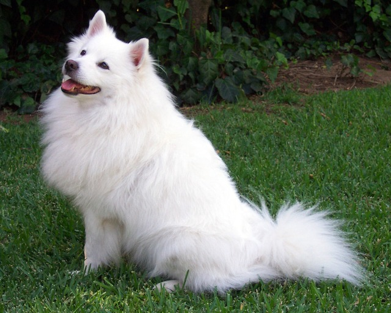
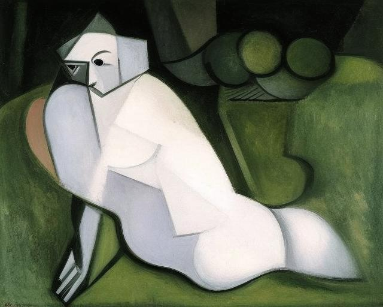
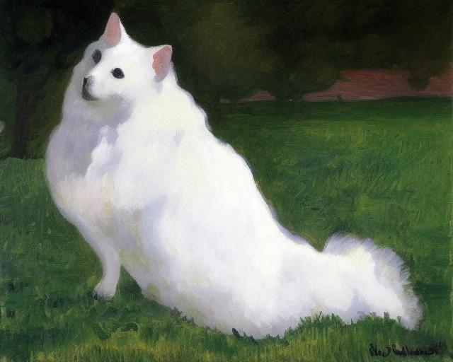
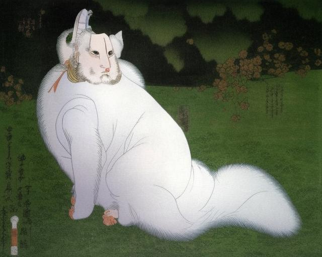

# Neural style transfer

Stable Diffusion 1.5 image-to-image and text-to-image style transfer built on custom rank-4 UNet LoRA adapters, a FastAPI inference server deployed on Modal L4 GPUs, and a reproducible Colab training workflow.

Live demo: [darrige.tech/projects/neural-style-lab](https://darrige.tech/projects/neural-style-lab)

## Before and after samples

Real image-to-image outputs from the deployed SD 1.5 LoRA service across all three production styles:

| Original input | Cubism | Post-Impressionism | Ukiyo-e |
| :---: | :---: | :---: | :---: |
|  |  |  |  |

## Architecture and inference pipeline

The inference server (`backend/main.py`) loads `runwayml/stable-diffusion-v1-5` paired with `stabilityai/sd-vae-ft-mse` to prevent FP16 VAE artifacts. Both `StableDiffusionPipeline` and `StableDiffusionImg2ImgPipeline` share a single UNet instance in GPU memory, keeping VRAM flat across modes.

For image-to-image requests, the backend runs `EulerAncestralDiscreteScheduler` for 50 steps and maps the user's single `strength` control (`0.0` to `1.0`) through a nonlinear curve (`u^1.6`) to denoising strength `[0.42, 0.62]` and LoRA scale `[0.95, 1.30]`. Cubism shifts `u` into `[0.5, 1.0]` before applying the curve so geometric abstraction shows up even at lower slider positions. Every generation runs inside a thread lock and unloads the active adapter in a `finally` block so state never leaks between requests.

Incoming base64 images are validated before decoding, capped at 10 MB (HTTP 413) and 4096x4096 pixels (HTTP 400), EXIF-transposed to RGB, and resized to aspect-preserving multiples of 8 within `[512, 768]`. Serverless production serving runs on an NVIDIA L4 via `backend/modal_app.py` with TF32 and cuDNN benchmarking enabled.

## Shipped LoRA adapters

Three rank-4 UNet adapters are tracked in `weights/manifest.json` and checked in CI:

| Style | File size | SHA-256 |
|---|---:|---|
| Cubism | 3,226,184 bytes (3.08 MiB) | `2a68d54f9d4e4d2341bfb4637500aa0750dc623b9c82da60da8ebf49dcdcb45e` |
| Post-Impressionism | 3,226,184 bytes (3.08 MiB) | `ae70f996a25278bb6e9a9eac1d09bbd909552ab99266f91f5ba38213ad933acf` |
| Ukiyo-e | 3,226,184 bytes (3.08 MiB) | `35237cd93e20156729f59088f61e61e088543f6e51d097b838a18e2b6c33bcc1` |

Each `.safetensors` file holds 256 FP32 tensors (797,184 parameters) targeting the SD 1.x UNet attention projections (`to_k`, `to_q`, `to_v`, `to_out.0`). Text encoder weights are untouched. Pop Art was trained in the same batch and archived without deployment.

## Training configuration and provenance

All four adapters came from one sequential Google Colab run reconstructed in [`Artoria_Colab_MultiStyle_LoRA_Training.ipynb`](Artoria_Colab_MultiStyle_LoRA_Training.ipynb) and audited in [`TRAINING_PROVENANCE.md`](TRAINING_PROVENANCE.md).

| Setting | Value |
|---|---|
| Base model | `runwayml/stable-diffusion-v1-5` |
| Dataset source | `h7alasaleh/artoria-dataset` (1,167 Ukiyo-e; 2,235 Cubism; 1,483 Pop Art; 6,310 Post-Impressionism) |
| Resolution | 512x512 (center crop, random horizontal flip) |
| Training steps | 1,000 per style |
| Batch size / grad accum | 1 / 4 |
| Learning rate | `1e-4` with cosine schedule |
| LoRA rank / alpha | 4 / 4 |
| Precision / seed | fp16 / 42 |

### Dataset

The [Artoria Dataset](https://www.kaggle.com/datasets/h7alasaleh/artoria-dataset) was co-created with a teammate as part of a Fundamentals of Machine Learning course project and is hosted on Kaggle.

## Running the API locally

```bash
pip install -r backend/requirements.txt
uvicorn backend.main:app --host 127.0.0.1 --port 8000
```

| Endpoint | Method | Behavior |
|---|---|---|
| `/health` | `GET` | Returns pipeline readiness, active device (`cuda` or `cpu`), supported styles, and adapter file presence. |
| `/generate` | `POST` | Accepts `style_type` (`cubism`, `post-impressionism`, `ukiyo-e`), optional `prompt`, `init_image` (base64), `strength` (`0.0` to `1.0`), and `seed`. Returns `image/jpeg`. |

## Tests

Run the CPU-only backend validation and SHA-256 manifest suite without downloading model weights:

```bash
SKIP_MODEL_LOAD=1 pytest -v
```

GitHub Actions (`.github/workflows/ci.yml`) runs this suite on every push and pull request.

## Project structure

- `backend/main.py`: FastAPI inference server, image validation, nonlinear strength mapping, and adapter lifecycle.
- `backend/modal_app.py`: Modal L4 ASGI deployment definition.
- `weights/`: Shipped rank-4 `.safetensors` adapters and `manifest.json`.
- `assets/samples/`: Verified before/after outputs from the deployed SD 1.5 service.
- `tests/test_backend.py`: Adapter SHA-256 integrity, upload limits, strength bounds, and `/health` tests.
- `Artoria_Colab_MultiStyle_LoRA_Training.ipynb`: Reproducible Colab training notebook.
- `TRAINING_PROVENANCE.md` and `run_summary.json`: Artifact hash chain and training metadata.

## Known limitations

- Pure image-to-image diffusion couples structure preservation and stylization to a single denoising strength parameter; without spatial conditioning, strong stylization can alter fine subject geometry.
- Shipped `.safetensors` binaries prove rank, tensor layout, dtype, and SHA-256 hashes, not dataset identity or optimizer state. Those training claims come from the recorded Colab notebook documented in `TRAINING_PROVENANCE.md`.
- Full inference requires a CUDA GPU (local, Colab, or Modal).
